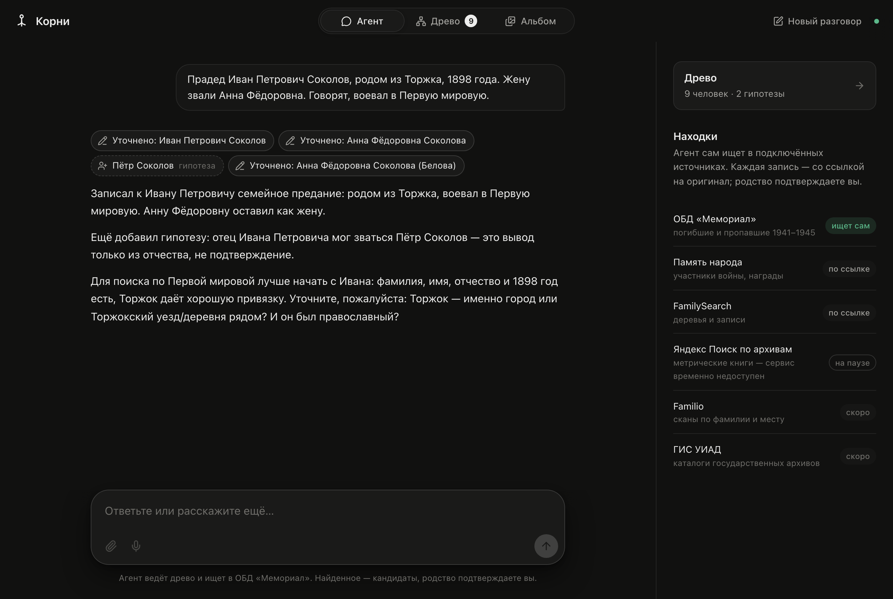
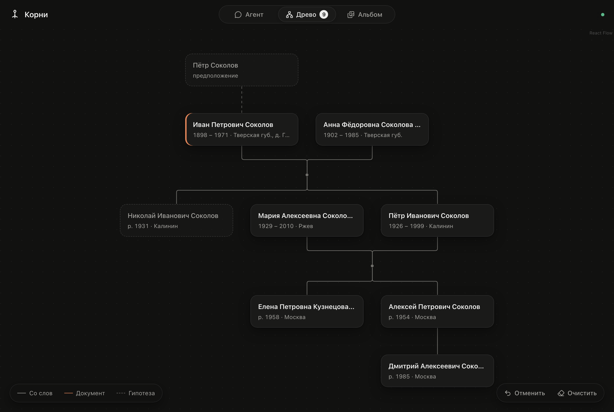

# Корни

Семейный исследователь. Человек рассказывает, что помнит о предках, а агент
заносит людей в древо и сам ищет их в открытых архивах. Каждая находка приходит
со ссылкой на оригинал, а решение о родстве принимает человек.

> Раньше в этом репозитории был проект **Family Memory**: семейное дерево и архив
> для нескольких семей. «Корни» пришли ему на смену. Последняя версия Family
> Memory сохранена под тегом [`family-memory-v1`](../../tree/family-memory-v1).





*На скриншотах вымышленная семья.*

## Что умеет

- **Расспрос → древо.** Агент сам добавляет и уточняет людей и связи
  (`add_person`, `update_person`, `link_people`, `unlink_people`, `remove_person`).
  У каждого факта есть происхождение: «со слов», «документ» или «гипотеза»
  (например, имя отца, выведенное из отчества). Любой шаг можно отменить.
- **Поиск по источникам.** В ОБД «Мемориал» агент сам ищет и читает карточки
  записей (`search_obd_memorial`, `read_obd_record`). Для «Памяти народа» и
  FamilySearch готовит ссылки на поиск. Капчи и логины не обходятся.
- **Доказательное дело под капотом.** Методология
  [`ex-ussr-kinship-research`](vendor/ex-ussr-kinship-research/) разделяет людей-кандидатов,
  артефакты, атомарные утверждения, противоречия, родственные связи и поисковые
  попытки. Древо остаётся простым семейным представлением и не подменяет доказательства.
- **Воспроизводимый поиск.** Запросы к ОБД, просмотренные карточки, внешний record ID,
  дата доступа, архивная ссылка и группы независимости сохраняются автоматически.
  Повторный URL или зеркало одной записи не считается новым подтверждением.
- **Альбом** с фото, письмами и голосами — в планах.

План, источники и бэклог описаны в [docs/plan.md](docs/plan.md), устройство
доказательного слоя — в [docs/evidence-engine-plan.md](docs/evidence-engine-plan.md),
правила для агентов — в [AGENTS.md](AGENTS.md).

## Запуск локально

Нужен Node.js 24+.

```bash
cp .env.example .env   # AI_PROVIDER=openai|anthropic, AI_MODEL и ключ провайдера
npm install
npx playwright install chromium   # браузер для поиска по источникам
npm run dev            # http://localhost:4310
```

Зелёная точка в шапке означает, что модель доступна. Если точка красная,
наведите на неё курсор, там будет причина.

## Деплой (Coolify)

В репозитории есть `Dockerfile`: он собирает клиент, ставит Chromium и запускает сервер.

| Настройка | Значение |
| --- | --- |
| Build pack | Dockerfile (`/Dockerfile`) |
| Порт | `4317` |
| Переменные | `AI_PROVIDER`, `AI_MODEL`, `OPENAI_API_KEY` или `ANTHROPIC_API_KEY` |
| Постоянный том | `/data`, здесь хранятся `tree.json` и `research-case.json` |

Авторизации пока нет: одна установка обслуживает одно общее древо.
Не открывайте сервис публично без защиты (например, Basic Auth в Coolify).

## Устройство

- `server/` — Express. `/api/chat` стримит ответ агента через AI SDK 7; evidence engine
  хранит дело, проводит структурный аудит и подключает релевантные модули методологии.
- `server/sources/` — адаптеры источников: общий Chromium с очередью запросов и паузой 2,5 с между ними.
- `src/` — React-клиент с вкладками «Агент», «Древо», «Альбом».
- `shared/` — общие типы для клиента и сервера.
- `vendor/ex-ussr-kinship-research/` — неизменённый MIT-снимок upstream-скилла;
  commit и обновление описаны в `UPSTREAM.md`.
- Древо хранится в `$DATA_DIR/tree.json` (по умолчанию `data/`, вне Git) вместе с
  историей для отмены. Доказательное дело хранится отдельно в
  `$DATA_DIR/research-case.json`, поэтому старые деревья читаются без миграции и потери данных.
- `/api/research`, `/api/research/audit` и `/api/research/report` дают локальный
  доступ к делу, аудиту и Markdown-отчёту. Авторизации пока нет, поэтому приложение
  нельзя публиковать без внешней защиты.

Проверка: `npm test` (инварианты evidence engine и policy-evals), затем
`npm run build` (типы и сборка клиента).
